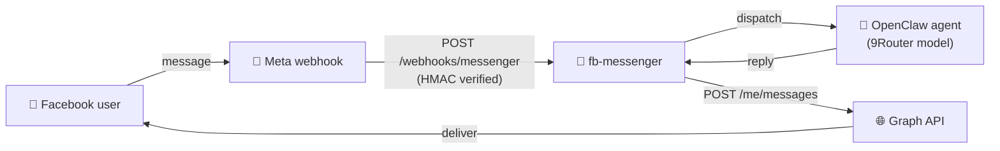

<div align="center">

# 💬 fb-messenger

### **Facebook Page Messenger** channel for OpenClaw - webhook in, Graph API out

*The plugin only moves messages. Replies are generated by your OpenClaw agent and model provider (e.g. **9Router**) - exactly like the Telegram and Zalo channels.*


[ Tiếng Việt](README.vi.md) ·  **English**

</div>

---

## 🎁 What is fb-messenger?

`fb-messenger` adds **Facebook Page Messenger** as a native OpenClaw channel, side by side with Telegram and Zalo. It handles only the plumbing - **inbound** events and **outbound** replies - while the OpenClaw agent does the thinking.

- 📥 **Inbound** - a public webhook (`/webhooks/messenger`) receives Meta events, verifies the `X-Hub-Signature-256` signature, and dispatches each message to the agent.
- 📤 **Outbound** - replies stream back through the Graph API (`POST /me/messages`), auto-chunked to fit Messenger's limit.
- 🪄 **Self-healing** - accepts a User token (auto-exchanged for the Page token), resolves the real Page ID, and **auto-subscribes the Page to the webhook on startup** - no manual Meta dashboard step.



---

## 📦 Requirements

| | |
|---|---|
| **OpenClaw** | `>= 2026.6.10` |
| **Public HTTPS URL** | pointing at your OpenClaw gateway (VPS domain, or ngrok/cloudflared for testing). Meta only delivers webhooks over HTTPS. |
| **Meta side** | a Facebook **Page** and a Meta **App** with the *Messenger* product enabled. |

---

## ⬇️ Install

```bash
# From ClawHub:
openclaw plugins install clawhub:tuanminhhole/openclaw-fb-messenger

# Update to the latest version later (force re-pull):
openclaw plugins install clawhub:tuanminhhole/openclaw-fb-messenger --force
```

The ClawHub package ships the prebuilt `dist/`, so there is **nothing to build** - install, configure (below), restart the gateway.

> 💡 Prefer a guided UI? [**openclaw-setup**](https://github.com/tuanminhhole/openclaw-setup) installs and configures this channel (Page token, webhook) straight from its dashboard.

---

## 🔗 Relay via MonkeyTech Connect (0.2.0, recommended)

From 0.2.0 the plugin no longer needs a public HTTPS endpoint, a Page token or a Meta developer
account on the bot's machine. MonkeyTech runs one reviewed Meta app at
[connect.monkeytech.vn](https://connect.monkeytech.vn); the Page owner clicks **Continue with
Facebook** once, Connect receives the webhooks and the gateway pulls them:

```
Messenger / Instagram -> Meta webhook -> connect.monkeytech.vn -> GET /api/events (long-poll, 25 s)
agent reply -> POST /api/pages/:id/messages on Connect -> Graph API (Page token stays on Connect)
```

- `transport` defaults to `relay` whenever no `pageAccessToken` is configured.
- The account key is the Page ID: `channels.fb-messenger.accounts["<pageId>"] = { enabled: true, name: "Shop" }`.
  Several Pages can share one gateway.
- The bot key is written by the Setup UI to `<state>/credentials/fb-messenger/relay.json`
  (`{ "botKey": "mck_..." }`), or passed as `FB_MESSENGER_RELAY_KEY`. `relayUrl` overrides the Connect
  base URL (self-hosted Connect).
- Instagram Direct arrives on the same account; peers are `ig:<igsid>` so the agent (and the `message`
  tool) can tell the two platforms apart.
- The old **webhook** transport is still available for people who run their own Meta app: set
  `transport: "webhook"` plus `pageAccessToken`, `verifyToken` and `appSecret` (now mandatory, unsigned
  webhooks are dropped).

## ⚙️ Configure

### 1. Meta App + Page

1. Create an app at <https://developers.facebook.com/apps> → add the **Messenger** product.
2. Under *Messenger → Settings*, generate a **Page Access Token** for your Page.
3. Note your **App Secret** (*App Settings → Basic*).
4. Choose any string as your **Verify Token** (you'll reuse the same value below).

### 2. Environment variables

```bash
FB_MESSENGER_PAGE_ACCESS_TOKEN=EAAB...      # any token - even a short-lived User token from the Graph API Explorer
FB_MESSENGER_APP_ID=1234567890              # Meta App ID - required to mint a never-expiring Page token
FB_MESSENGER_APP_SECRET=xxxxxxxx            # App Secret (signature verification + token exchange)
FB_MESSENGER_VERIFY_TOKEN=my-verify-token   # any string you choose
```

> 🔑 **Never-expiring token, automatically.** On startup the plugin exchanges whatever you paste (short-lived User token → long-lived User token → **permanent Page token**) and caches the Page token under `.openclaw/credentials/fb-messenger/`, so the bot keeps working after the input token expires. Providing `FB_MESSENGER_APP_ID` + `FB_MESSENGER_APP_SECRET` is what makes the result permanent.

### 3. `openclaw.json`

```jsonc
{
  "channels": {
    "fb-messenger": {
      "enabled": true,
      "dmPolicy": "open",       // open | allowlist | pairing | disabled
      "allowFrom": ["*"],
      "historyLimit": 50
    }
  }
}
```

> 🔐 Secrets (`pageAccessToken`, `appSecret`, `verifyToken`) are read from the environment first, so they don't need to live in `openclaw.json`. `pageId` is optional - the plugin resolves it from the token.

### 4. Expose a public HTTPS endpoint

Meta only delivers webhooks to a **public HTTPS URL**, but your gateway listens on a local port (e.g. `:18789`, often inside Docker). You need a tunnel/reverse proxy in front of it.

> ⚠️ **Use a *stable* URL.** The quick one-liners below (`ngrok http 18789`, `cloudflared tunnel --url …`) hand out a **random URL that changes every time the tunnel restarts** - and each change forces you to re-edit the Callback URL in Meta. Pick one of the permanent options instead so you configure Meta **once**.
>
> 🐳 The tunnel runs on the **host**, not inside the container - so restarting Docker does **not** change the URL as long as the tunnel process stays up. The URL only changes if the *tunnel itself* restarts in ephemeral mode.

**Option A - ngrok static domain (free, fastest):**

```bash
# 1. dashboard.ngrok.com → Domains → claim 1 free static domain, e.g. mybot.ngrok-free.app
# 2. Run bound to that domain (URL never changes):
ngrok http --url=mybot.ngrok-free.app 18789
```
→ Callback URL: `https://mybot.ngrok-free.app/webhooks/messenger`

**Option B - Cloudflare named tunnel (free, best for production; needs your own domain on Cloudflare):**

```bash
cloudflared tunnel login
cloudflared tunnel create openclaw
cloudflared tunnel route dns openclaw fb.yourdomain.com
cloudflared tunnel run --url http://localhost:18789 openclaw
```
→ Callback URL: `https://fb.yourdomain.com/webhooks/messenger`

**Option C - VPS with a real domain + TLS** (nginx/Caddy reverse-proxy to `:18789`). Most stable; no third-party tunnel.

### 5. Register the webhook with Meta

In *Messenger → Settings → Webhooks*:

- **Callback URL**: `https://<your-public-domain>/webhooks/messenger`
- **Verify Token**: the same value as `FB_MESSENGER_VERIFY_TOKEN`
- **Subscription fields**: at minimum `messages` (and `messaging_postbacks` if you use buttons).

> 💡 The plugin **auto-subscribes the Page to the app webhook on startup**, so you can skip the "Edit Page Subscriptions" step. You only declare the Callback URL + Verify Token above.
>
> 🔎 Sanity check before pasting into Meta - the GET handshake should echo the challenge:
> ```bash
> curl "https://<your-public-domain>/webhooks/messenger?hub.mode=subscribe&hub.verify_token=<FB_MESSENGER_VERIFY_TOKEN>&hub.challenge=ping"
> # → ping
> ```

---

## 🗺️ Scope

**v1** - 1:1 (direct) text conversations, DM policy / allowlist, signature verification, auto chunking, token self-healing, auto-subscribe.

**Not yet (v2)** - groups / multi-page, quick-reply buttons & persistent menu, proactive (agent-initiated) sends, reactions, handover protocol.

---

## 📄 License

Proprietary - © 2026 tuanminhhole. All rights reserved. See [LICENSE](LICENSE).

---

## 🙌 Author

Built by **[tuanminhhole (Kent)](https://github.com/tuanminhhole)**. Issues and improvement PRs welcome - if this saved you time, a ⭐ helps others find it.

---

## 🦞 OpenClaw ecosystem (same author)

Companion repos for building a complete, self-running AI assistant:

**🚀 Setup & framework**
- [openclaw-setup](https://github.com/tuanminhhole/openclaw-setup) - Install & configure AI bots (Telegram / Zalo / Messenger) with OpenClaw + 9Router + Docker - visual dashboard
- [9router](https://github.com/tuanminhhole/9router) - Connect every AI code tool to 40+ providers & 100+ models
- [vietbrain](https://github.com/tuanminhhole/vietbrain) - Vietnamese "Second Brain" framework for Obsidian (AI-ready)

**🔌 Plugins (runtime)**
- `openclaw-fb-messenger` - Facebook Messenger channel *(this repo)*
- [openclaw-zalo-mod](https://github.com/tuanminhhole/openclaw-zalo-mod) - Zero-token Zalo group moderation (slash commands, anti-spam, warn, memory)
- [openclaw-browser-automation](https://github.com/tuanminhhole/openclaw-browser-automation) - Smart Search & Browser Automation over CDP
- [openclaw-telegram-multibot-relay](https://github.com/tuanminhhole/openclaw-telegram-multibot-relay) - Telegram multibot relay, delegation & native cron reminders
- [openclaw-facebook-crawler](https://github.com/tuanminhhole/openclaw-facebook-crawler) - Facebook group listing crawler
- [openclaw-n8n-facebook-poster](https://github.com/tuanminhhole/openclaw-n8n-facebook-poster) - Post to Facebook via an n8n webhook

**🧩 Skills**
- [openclaw-skill-learning-memory](https://github.com/tuanminhhole/openclaw-skill-learning-memory) - Self-evolving long-term memory (Super Memory)
- [openclaw-skill-infographic](https://github.com/tuanminhhole/openclaw-skill-infographic) - Generate infographics / banners / posters
- [openclaw-skill-zalo-sticker-mention](https://github.com/tuanminhhole/openclaw-skill-zalo-sticker-mention) - Auto-tag sender + send stickers on Zalo

---

<div align="center">
<sub>🦞 <b>openclaw-fb-messenger</b> · part of the <a href="https://github.com/tuanminhhole">tuanminhhole (Kent)</a> OpenClaw ecosystem</sub>
</div>
