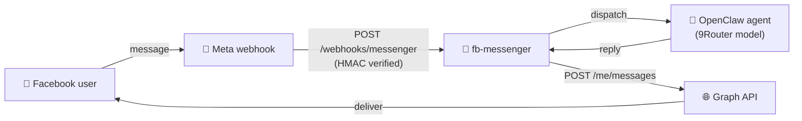

<div align="center">

# 💬 fb-messenger

### **Facebook Page Messenger** channel for OpenClaw — webhook in, Graph API out

*The plugin only moves messages. Replies are generated by your OpenClaw agent and model provider (e.g. **9Router**) — exactly like the Telegram and Zalo channels.*


[ Tiếng Việt](README.vi.md) ·  **English**

</div>

---

## 🎁 What is fb-messenger?

`fb-messenger` adds **Facebook Page Messenger** as a native OpenClaw channel, side by side with Telegram and Zalo. It handles only the plumbing — **inbound** events and **outbound** replies — while the OpenClaw agent does the thinking.

- 📥 **Inbound** — a public webhook (`/webhooks/messenger`) receives Meta events, verifies the `X-Hub-Signature-256` signature, and dispatches each message to the agent.
- 📤 **Outbound** — replies stream back through the Graph API (`POST /me/messages`), auto-chunked to fit Messenger's limit.
- 🪄 **Self-healing** — accepts a User token (auto-exchanged for the Page token), resolves the real Page ID, and **auto-subscribes the Page to the webhook on startup** — no manual Meta dashboard step.



---

## 📦 Requirements

| | |
|---|---|
| **OpenClaw** | `>= 2026.6.10` |
| **Public HTTPS URL** | pointing at your OpenClaw gateway (VPS domain, or ngrok/cloudflared for testing). Meta only delivers webhooks over HTTPS. |
| **Meta side** | a Facebook **Page** and a Meta **App** with the *Messenger* product enabled. |

---

## ⬇️ Install

```bash
# From ClawHub (private, under the tuanminhhole org):
openclaw plugins install clawhub:tuanminhhole/openclaw-fb-messenger
```

---

## ⚙️ Configure

### 1. Meta App + Page

1. Create an app at <https://developers.facebook.com/apps> → add the **Messenger** product.
2. Under *Messenger → Settings*, generate a **Page Access Token** for your Page.
3. Note your **App Secret** (*App Settings → Basic*).
4. Choose any string as your **Verify Token** (you'll reuse the same value below).

### 2. Environment variables

```bash
FB_MESSENGER_PAGE_ACCESS_TOKEN=EAAB...      # any token — even a short-lived User token from the Graph API Explorer
FB_MESSENGER_APP_ID=1234567890              # Meta App ID — required to mint a never-expiring Page token
FB_MESSENGER_APP_SECRET=xxxxxxxx            # App Secret (signature verification + token exchange)
FB_MESSENGER_VERIFY_TOKEN=my-verify-token   # any string you choose
```

> 🔑 **Never-expiring token, automatically.** On startup the plugin exchanges whatever you paste (short-lived User token → long-lived User token → **permanent Page token**) and caches the Page token under `.openclaw/credentials/fb-messenger/`, so the bot keeps working after the input token expires. Providing `FB_MESSENGER_APP_ID` + `FB_MESSENGER_APP_SECRET` is what makes the result permanent.

### 3. `openclaw.json`

```jsonc
{
  "channels": {
    "fb-messenger": {
      "enabled": true,
      "dmPolicy": "open",       // open | allowlist | pairing | disabled
      "allowFrom": ["*"],
      "historyLimit": 50
    }
  }
}
```

> 🔐 Secrets (`pageAccessToken`, `appSecret`, `verifyToken`) are read from the environment first, so they don't need to live in `openclaw.json`. `pageId` is optional — the plugin resolves it from the token.

### 4. Register the webhook with Meta

In *Messenger → Settings → Webhooks*:

- **Callback URL**: `https://<your-gateway-domain>/webhooks/messenger`
- **Verify Token**: the same value as `FB_MESSENGER_VERIFY_TOKEN`
- **Subscription fields**: at minimum `messages` (and `messaging_postbacks` if you use buttons).

> 💡 The plugin **auto-subscribes the Page to the app webhook on startup**, so you can skip the "Edit Page Subscriptions" step. You only declare the Callback URL + Verify Token above.

---

## 🧪 Verify it works

```bash
npm install
npm run typecheck   # tsc --noEmit
npm run build       # bundle to dist/
```

Then start your OpenClaw gateway and message the Page from a Facebook account.

---

## 🗺️ Scope

**v1** — 1:1 (direct) text conversations, DM policy / allowlist, signature verification, auto chunking, token self-healing, auto-subscribe.

**Not yet (v2)** — groups / multi-page, quick-reply buttons & persistent menu, proactive (agent-initiated) sends, reactions, handover protocol.

---

## 📄 License

Proprietary — © 2026 tuanminhhole. All rights reserved. See [LICENSE](LICENSE).
