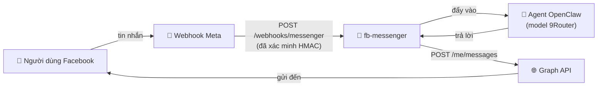

<div align="center">

# 💬 fb-messenger

### Kênh **Facebook Page Messenger** cho OpenClaw — webhook vào, Graph API ra

*Plugin chỉ lo vận chuyển tin nhắn. Câu trả lời do agent OpenClaw và provider model bạn cấu hình (ví dụ **9Router**) sinh ra — giống hệt kênh Telegram và Zalo.*


 **Tiếng Việt** · [ English](README.md)

</div>

---

## 🎁 fb-messenger là gì?

`fb-messenger` thêm **Facebook Page Messenger** thành một kênh OpenClaw, song song với Telegram và Zalo. Plugin chỉ lo phần đường ống — **nhận** sự kiện và **gửi** câu trả lời — còn phần "suy nghĩ" do agent OpenClaw đảm nhận.

- 📥 **Inbound** — webhook công khai (`/webhooks/messenger`) nhận sự kiện Meta, xác minh chữ ký `X-Hub-Signature-256`, rồi đẩy từng tin vào agent.
- 📤 **Outbound** — trả lời stream về qua Graph API (`POST /me/messages`), tự chunk cho vừa giới hạn Messenger.
- 🪄 **Tự chữa lành** — nhận cả User token (tự đổi sang Page token), tự suy ra đúng Page ID, và **tự subscribe Page vào webhook lúc khởi động** — không cần thao tác tay trên dashboard Meta.



---

## 📦 Yêu cầu

| | |
|---|---|
| **OpenClaw** | `>= 2026.6.10` |
| **URL HTTPS công khai** | trỏ về gateway OpenClaw (domain VPS, hoặc ngrok/cloudflared khi test). Meta chỉ gửi webhook qua HTTPS. |
| **Phía Meta** | một **Page** Facebook và một **App** Meta đã bật sản phẩm *Messenger*. |

---

## ⬇️ Cài đặt

```bash
# Từ ClawHub (riêng tư, dưới org tuanminhhole):
openclaw plugins install clawhub:tuanminhhole/openclaw-fb-messenger
```

---

## ⚙️ Cấu hình

### 1. Meta App + Page

1. Tạo app tại <https://developers.facebook.com/apps> → thêm sản phẩm **Messenger**.
2. Vào *Messenger → Settings* → tạo **Page Access Token** cho Page.
3. Lấy **App Secret** (*App Settings → Basic*).
4. Tự chọn một chuỗi làm **Verify Token** (dùng lại đúng giá trị này bên dưới).

### 2. Biến môi trường

```bash
FB_MESSENGER_PAGE_ACCESS_TOKEN=EAAB...      # Page token (hoặc User token — plugin tự đổi)
FB_MESSENGER_APP_SECRET=xxxxxxxx            # App Secret (xác minh chữ ký)
FB_MESSENGER_VERIFY_TOKEN=chuoi-tu-chon     # tuỳ bạn đặt
```

### 3. `openclaw.json`

```jsonc
{
  "channels": {
    "fb-messenger": {
      "enabled": true,
      "dmPolicy": "open",       // open | allowlist | pairing | disabled
      "allowFrom": ["*"],
      "historyLimit": 50
    }
  }
}
```

> 🔐 Bí mật (`pageAccessToken`, `appSecret`, `verifyToken`) được đọc từ env trước nên không cần ghi vào `openclaw.json`. `pageId` không bắt buộc — plugin tự suy ra từ token.

### 4. Đăng ký webhook với Meta

Vào *Messenger → Settings → Webhooks*:

- **Callback URL**: `https://<domain-gateway>/webhooks/messenger`
- **Verify Token**: trùng với `FB_MESSENGER_VERIFY_TOKEN`
- **Subscription fields**: tối thiểu `messages` (+ `messaging_postbacks` nếu dùng nút).

> 💡 Việc subscribe Page vào app được plugin **tự làm** lúc khởi động, nên bạn có thể bỏ qua bước "Edit Page Subscriptions". Bạn chỉ cần khai báo Callback URL + Verify Token ở trên.

---

## 🧪 Kiểm tra

```bash
npm install
npm run typecheck   # tsc --noEmit
npm run build       # đóng gói vào dist/
```

Sau đó khởi động gateway OpenClaw và nhắn tin cho Page từ một tài khoản Facebook.

---

## 🗺️ Phạm vi

**v1** — hội thoại 1:1 (DM) dạng text, DM policy / allowlist, xác minh chữ ký, tự chunk, token tự chữa lành, tự subscribe.

**Chưa có (v2)** — nhóm / đa Page, nút quick-reply & menu cố định, gửi chủ động (agent khởi xướng), reactions, handover.

---

## 📄 Giấy phép

Proprietary — © 2026 tuanminhhole. Bảo lưu mọi quyền. Xem [LICENSE](LICENSE).
