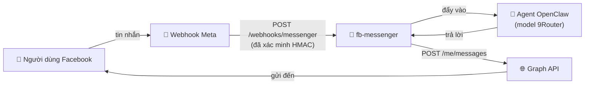

<div align="center">

# 💬 fb-messenger

### Kênh **Facebook Page Messenger** cho OpenClaw — webhook vào, Graph API ra

*Plugin chỉ lo vận chuyển tin nhắn. Câu trả lời do agent OpenClaw và provider model bạn cấu hình (ví dụ **9Router**) sinh ra — giống hệt kênh Telegram và Zalo.*


 **Tiếng Việt** · [ English](README.md)

</div>

---

## 🎁 fb-messenger là gì?

`fb-messenger` thêm **Facebook Page Messenger** thành một kênh OpenClaw, song song với Telegram và Zalo. Plugin chỉ lo phần đường ống — **nhận** sự kiện và **gửi** câu trả lời — còn phần "suy nghĩ" do agent OpenClaw đảm nhận.

- 📥 **Inbound** — webhook công khai (`/webhooks/messenger`) nhận sự kiện Meta, xác minh chữ ký `X-Hub-Signature-256`, rồi đẩy từng tin vào agent.
- 📤 **Outbound** — trả lời stream về qua Graph API (`POST /me/messages`), tự chunk cho vừa giới hạn Messenger.
- 🪄 **Tự chữa lành** — nhận cả User token (tự đổi sang Page token), tự suy ra đúng Page ID, và **tự subscribe Page vào webhook lúc khởi động** — không cần thao tác tay trên dashboard Meta.



---

## 📦 Yêu cầu

| | |
|---|---|
| **OpenClaw** | `>= 2026.6.10` |
| **URL HTTPS công khai** | trỏ về gateway OpenClaw (domain VPS, hoặc ngrok/cloudflared khi test). Meta chỉ gửi webhook qua HTTPS. |
| **Phía Meta** | một **Page** Facebook và một **App** Meta đã bật sản phẩm *Messenger*. |

---

## ⬇️ Cài đặt

```bash
# Từ ClawHub:
openclaw plugins install clawhub:tuanminhhole/openclaw-fb-messenger

# Cập nhật lên bản mới sau này (ép tải lại):
openclaw plugins install clawhub:tuanminhhole/openclaw-fb-messenger --force
```

Gói ClawHub đã kèm sẵn `dist/` build sẵn, nên **không cần build gì cả** — cài xong, cấu hình (bên dưới), khởi động lại gateway.

> 💡 Muốn cài qua giao diện? [**openclaw-setup**](https://github.com/tuanminhhole/openclaw-setup) cài & cấu hình kênh này (Page token, webhook) ngay trên dashboard.

---

## ⚙️ Cấu hình

### 1. Meta App + Page

1. Tạo app tại <https://developers.facebook.com/apps> → thêm sản phẩm **Messenger**.
2. Vào *Messenger → Settings* → tạo **Page Access Token** cho Page.
3. Lấy **App Secret** (*App Settings → Basic*).
4. Tự chọn một chuỗi làm **Verify Token** (dùng lại đúng giá trị này bên dưới).

### 2. Biến môi trường

```bash
FB_MESSENGER_PAGE_ACCESS_TOKEN=EAAB...      # token bất kỳ — kể cả User token ngắn hạn lấy từ Graph API Explorer
FB_MESSENGER_APP_ID=1234567890              # App ID của Meta — cần để tạo Page token KHÔNG hết hạn
FB_MESSENGER_APP_SECRET=xxxxxxxx            # App Secret (xác minh chữ ký + đổi token)
FB_MESSENGER_VERIFY_TOKEN=chuoi-tu-chon     # tuỳ bạn đặt
```

> 🔑 **Tự động lấy token vĩnh viễn.** Lúc khởi động, plugin tự đổi token bạn dán (User token ngắn hạn → long-lived → **Page token vĩnh viễn**) rồi lưu Page token vào `.openclaw/credentials/fb-messenger/`, nên bot vẫn chạy sau khi token gốc hết hạn. Có `FB_MESSENGER_APP_ID` + `FB_MESSENGER_APP_SECRET` thì token mới thật sự vĩnh viễn.

### 3. `openclaw.json`

```jsonc
{
  "channels": {
    "fb-messenger": {
      "enabled": true,
      "dmPolicy": "open",       // open | allowlist | pairing | disabled
      "allowFrom": ["*"],
      "historyLimit": 50
    }
  }
}
```

> 🔐 Bí mật (`pageAccessToken`, `appSecret`, `verifyToken`) được đọc từ env trước nên không cần ghi vào `openclaw.json`. `pageId` không bắt buộc — plugin tự suy ra từ token.

### 4. Tạo endpoint HTTPS công khai

Meta chỉ gửi webhook tới **URL HTTPS công khai**, trong khi gateway của bạn nghe ở cổng nội bộ (vd `:18789`, thường nằm trong Docker). Cần một tunnel/reverse-proxy đứng trước nó.

> ⚠️ **Dùng URL *cố định*.** Hai lệnh nhanh bên dưới (`ngrok http 18789`, `cloudflared tunnel --url …`) cấp một **URL ngẫu nhiên, đổi mỗi lần tunnel khởi động lại** — mỗi lần đổi là phải vào Meta sửa lại Callback URL. Hãy chọn một trong các phương án cố định để cấu hình Meta **một lần duy nhất**.
>
> 🐳 Tunnel chạy trên **host**, không nằm trong container — nên **restart Docker KHÔNG làm đổi URL** miễn là tiến trình tunnel còn sống. URL chỉ đổi khi *bản thân tunnel* khởi động lại ở chế độ tạm.

**Cách A — ngrok static domain (miễn phí, nhanh nhất):**

```bash
# 1. dashboard.ngrok.com → Domains → claim 1 domain tĩnh free, vd: mybot.ngrok-free.app
# 2. Chạy gắn với domain đó (URL không bao giờ đổi):
ngrok http --url=mybot.ngrok-free.app 18789
```
→ Callback URL: `https://mybot.ngrok-free.app/webhooks/messenger`

**Cách B — Cloudflare named tunnel (miễn phí, tốt cho production; cần domain riêng đã add vào Cloudflare):**

```bash
cloudflared tunnel login
cloudflared tunnel create openclaw
cloudflared tunnel route dns openclaw fb.tenmiencuaban.com
cloudflared tunnel run --url http://localhost:18789 openclaw
```
→ Callback URL: `https://fb.tenmiencuaban.com/webhooks/messenger`

**Cách C — VPS có domain thật + TLS** (nginx/Caddy reverse-proxy về `:18789`). Ổn định nhất, không phụ thuộc tunnel bên thứ ba.

### 5. Đăng ký webhook với Meta

Vào *Messenger → Settings → Webhooks*:

- **Callback URL**: `https://<domain-cong-khai>/webhooks/messenger`
- **Verify Token**: trùng với `FB_MESSENGER_VERIFY_TOKEN`
- **Subscription fields**: tối thiểu `messages` (+ `messaging_postbacks` nếu dùng nút).

> 💡 Việc subscribe Page vào app được plugin **tự làm** lúc khởi động, nên bạn có thể bỏ qua bước "Edit Page Subscriptions". Bạn chỉ cần khai báo Callback URL + Verify Token ở trên.
>
> 🔎 Kiểm tra nhanh trước khi dán vào Meta — handshake GET phải trả lại đúng challenge:
> ```bash
> curl "https://<domain-cong-khai>/webhooks/messenger?hub.mode=subscribe&hub.verify_token=<FB_MESSENGER_VERIFY_TOKEN>&hub.challenge=ping"
> # → ping
> ```

---

## 🗺️ Phạm vi

**v1** — hội thoại 1:1 (DM) dạng text, DM policy / allowlist, xác minh chữ ký, tự chunk, token tự chữa lành, tự subscribe.

**Chưa có (v2)** — nhóm / đa Page, nút quick-reply & menu cố định, gửi chủ động (agent khởi xướng), reactions, handover.

---

## 📄 Giấy phép

Proprietary — © 2026 tuanminhhole. Bảo lưu mọi quyền. Xem [LICENSE](LICENSE).

---

## 🙌 Tác giả

Làm bởi **[tuanminhhole (Kent)](https://github.com/tuanminhhole)**. Mọi issue / PR cải tiến đều được hoan nghênh — thấy hữu ích thì ⭐ repo để nhiều người biết tới nhé!

---

## 🦞 Hệ sinh thái OpenClaw (cùng tác giả)

Các repo đi kèm để bạn dựng một trợ lý AI "tự vận hành" hoàn chỉnh:

**🚀 Cài đặt & khung nền**
- [openclaw-setup](https://github.com/tuanminhhole/openclaw-setup) — Cài & cấu hình bot AI (Telegram / Zalo / Messenger) bằng OpenClaw + 9Router + Docker — có dashboard trực quan
- [9router](https://github.com/tuanminhhole/9router) — Nối mọi AI code tool tới 40+ nhà cung cấp & 100+ model
- [vietbrain](https://github.com/tuanminhhole/vietbrain) — Bộ khung "Bộ Não Thứ Hai" tiếng Việt cho Obsidian (sẵn sàng AI)

**🔌 Plugin (runtime)**
- `openclaw-fb-messenger` — Kênh Facebook Messenger *(repo này)*
- [openclaw-zalo-mod](https://github.com/tuanminhhole/openclaw-zalo-mod) — Quản lý nhóm Zalo zero-token (slash command, anti-spam, warn, memory)
- [openclaw-browser-automation](https://github.com/tuanminhhole/openclaw-browser-automation) — Smart Search & Browser Automation qua CDP
- [openclaw-telegram-multibot-relay](https://github.com/tuanminhhole/openclaw-telegram-multibot-relay) — Multibot Telegram relay, delegation & cron nhắc lịch native
- [openclaw-facebook-crawler](https://github.com/tuanminhhole/openclaw-facebook-crawler) — Crawl tin đăng trong group Facebook
- [openclaw-n8n-facebook-poster](https://github.com/tuanminhhole/openclaw-n8n-facebook-poster) — Đăng bài Facebook qua webhook n8n

**🧩 Skill**
- [openclaw-skill-learning-memory](https://github.com/tuanminhhole/openclaw-skill-learning-memory) — Bộ nhớ dài hạn tự tiến hoá (Super Memory)
- [openclaw-skill-infographic](https://github.com/tuanminhhole/openclaw-skill-infographic) — Tạo infographic / banner / poster
- [openclaw-skill-zalo-sticker-mention](https://github.com/tuanminhhole/openclaw-skill-zalo-sticker-mention) — Tự tag người gửi + gửi sticker trên Zalo

---

<div align="center">
<sub>🦞 <b>openclaw-fb-messenger</b> · một phần của hệ sinh thái <a href="https://github.com/tuanminhhole">tuanminhhole (Kent)</a></sub>
</div>
